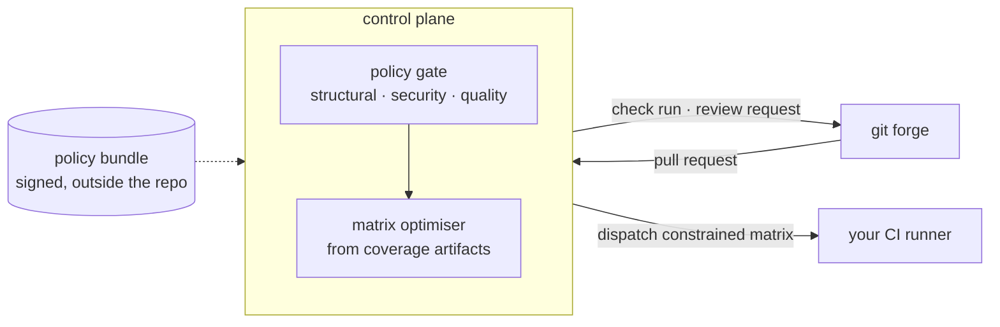

# Open CI Control Plane

A self-hosted gate between your git forge and your CI runner. It decides what is allowed to
merge, and what actually needs to run.

  

> **Status: in development, nothing to run yet.** The specification is signed off and phase 1
> is under way. The policy input contract, the GitHub forge adapter, webhook authentication
> and the embedded OPA engine exist as packages under `internal/`, but there is no binary and
> nothing to install. If you are looking for something runnable, come back later.

## The problem

AI coding agents produce code faster than review scales to, and the tooling meant to catch
what they get wrong frequently isn't switched on, isn't blocking, or can't see the defect.
Worse, every one of those controls lives **inside the repository it protects** — so it is only
as strong as the weakest repo's config file, and the agent whose output it constrains can edit
it. "Make CI pass" is a reasonable-looking instruction, and weakening a scanner is a
reasonable-looking way to satisfy it.

Meanwhile pipelines boot expensive environments to discover failures that were decidable from
the diff.

## What it does



**A deterministic policy gate.** Policy evaluates structural facts about a diff — imports,
module graph, changed paths, analyzer findings — and refuses what should not pass on tooling
alone. Security is one family of rules. Architectural boundaries and code conventions are
others.

**A test matrix optimiser.** Maps the diff to the suites that cover it and emits a constrained
matrix, with an always-run set and confidence triggers that fall back to everything.

**Orchestration and telemetry.** Check runs, inline comments, pipeline dispatch, and a metrics
API your developer portal reads. No bundled UI.

The property that makes it work: **policy lives in a different repository with different write
permissions from the code it governs.** The governed party cannot exempt itself.

## What it is not

- **Not a code generator.** It never writes, suggests or modifies your code.
- **Not a replacement for CI.** It calculates the instructions and delegates execution.
- **Not an analyzer.** Semgrep, Trivy and friends plug in through a JSON contract; it
  orchestrates, it does not reimplement.
- **Not an opinion about how to build software.** No architectural style is built into the
  engine. Clean architecture ships as one opt-in example pack among several.

## Quick start

There is nothing to run yet. There is a development environment and a test suite:

```sh
nix develop            # go 1.26, opa, regal, golangci-lint, staticcheck, syft, cosign
go test ./...          # inside the dev shell
```

Without Nix, you need Go 1.26 or later, the [OPA CLI](https://www.openpolicyagent.org/docs/cli)
and `cmark-gfm` on your `PATH`, because the suite calls both.

## Documentation

| Where | What |
|---|---|
| [Specification](https://claude.ai/code/artifact/db03f5d3-b4e0-4fb0-8254-375c6cf0d08d) | Full systems analysis and design — requirements, contracts, decisions, threat model |
| `docs/knowledge-base/technology/` | OPA and Rego, pinned to v1.21.2 and verified by executing it |
| `docs/knowledge-base/architecture/` | Dependency direction, ports and adapters, coupling, boundaries |
| `docs/knowledge-base/engineering/` | Construction standards and the red-green-refactor cycle |
| `docs/knowledge-base/security/` | Secure coding, and the OWASP Top 10:2025 one entry per category |
| `docs/knowledge-base/design-patterns/` | The Gang of Four catalogue, one file per pattern |
| `schema/ci.diff.v1.schema.json` | The policy input contract, as a JSON Schema. Every emitted document is tested against it |
| `CLAUDE.md` | Router for agent sessions. Read it before changing anything |

## Contributing

Two conventions are not negotiable, and both are enforced rather than requested.

**Test first, and refactor after.** The cycle is red, green, **refactor** — a failing test
before any code, the minimum to pass it, then restructure against the standards in
`docs/knowledge-base/`. A `Stop` hook refuses to end a turn that edited source without stating a
refactor verdict, and a git `pre-commit` hook refuses a commit with a red suite, unformatted
files, or `go vet` failures. See `.claude/rules/tdd-cycle.md`.

The git hook lives in `.githooks/`, and git does not enable it on clone. Wire it once per
checkout:

```sh
git config core.hooksPath .githooks
```

**Comments are a last resort.** Doc comments follow the
[Google Go style](https://google.github.io/styleguide/go/decisions): complete sentences
beginning with the name of the thing. Anything else needs a reason that lives outside the code
and a reference to it. No narration.

## Licence

GPL-3.0-or-later. See `LICENSE`.
